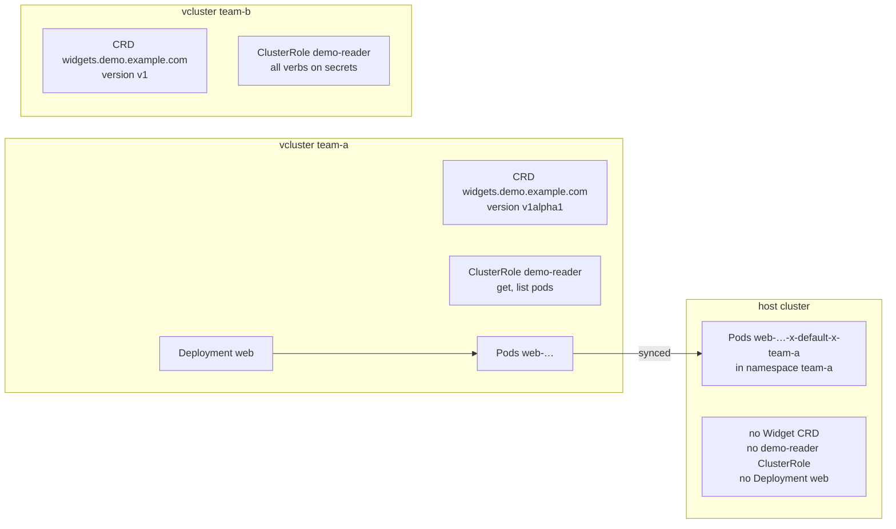

# 02 · vCluster

[← 01 Chainsaw](../01_chainsaw/README.md) · [Overview](../README.md) · [03 Chainsaw + vCluster →](../03_chainsaw-with-vcluster/README.md)

## What is vCluster?

TL;DR: [vCluster](https://github.com/loft-sh/vcluster) creates tenant clusters: fully isolated environments. Each gets its own API server, CRDs and RBAC, and runs on an existing cluster.

Each virtual cluster runs its own control plane: an API server, a controller manager and a backing store, all inside a single pod. A **syncer** copies the low-level workload resources (Pods, Services, …) to the host, where the host scheduler and kubelets run them. Everything else, including CRDs, ClusterRoles, Namespaces, Deployments and webhooks, exists **only in the virtual cluster**.

Diagram: https://www.vcluster.com/docs/vcluster/introduction/architecture/#on-an-existing-kubernetes-cluster

### What lives where (default configuration)

| Resource | Inside the vCluster | On the host |
|---|---|---|
| Pods, Services, Endpoints, PVCs, ConfigMaps and Secrets used by pods | ✅ | ✅ synced and renamed to `<name>-x-<namespace>-x-<vcluster>` in the vCluster's host namespace (truncated and hashed if too long) |
| Deployments, ReplicaSets, StatefulSets, Jobs | ✅ | ❌ reconciled by the *virtual* controller manager |
| **CRDs and custom resources** | ✅ | ❌ |
| **ClusterRoles, ClusterRoleBindings, Namespaces** | ✅ | ❌ |
| Admission webhooks | ✅ | ❌ |
| Nodes, StorageClasses | ✅ read-only view, mirrored from the host | ✅ |

## What can it be used for?

- **No cluster-wide clashes.** Every vCluster has its own CRDs, ClusterRoles and webhooks. Two vClusters can install *different versions of the same operator* on the same host.
- **Ephemeral test environments.** A fresh cluster takes seconds to create and is gone with one command. That suits CI pipelines and PR previews, and you never have to clean up a shared cluster.
- **Cheap.** There are no extra nodes. Workloads share the host's nodes, CNI and storage.
- **Real clusters for tenants.** Tenants get cluster-admin in their vCluster but are confined to a namespace on the host.
- **Version skew.** The virtual control plane can run a different Kubernetes version than the host.
- **e2e tests of Kubernetes Operators**

Learn more: [vCluster architecture](https://www.vcluster.com/docs/vcluster/introduction/architecture) · [What gets synced](https://www.vcluster.com/docs/vcluster/configure/vcluster-yaml/sync/) · [vCluster docs](https://www.vcluster.com/docs/vcluster/)

## Demo

This demo creates two virtual clusters, `team-a` and `team-b`, on the same kind host and shows that:

1. **Pods are synced** to the host, but higher-level objects such as Deployments aren't.
2. **Cluster-wide resources** (ClusterRole, CRD) with the *same name* coexist in both vClusters with *different content*, and don't exist on the host.



### 0. Prerequisite

You need the kind host cluster from the [setup](../README.md#setup):

```bash
kubectl config use-context kind-chainsaw-vcluster-demo
```

### 1. Create two virtual clusters

```bash
cd 02_vcluster
vcluster --context kind-chainsaw-vcluster-demo create team-a --namespace team-a
vcluster --context kind-chainsaw-vcluster-demo create team-b --namespace team-b
```

```bash
vcluster list
kubectl config get-context
```

Reset used context

```bash
kubectl config use-context kind-chainsaw-vcluster-demo
```

On the host, a vCluster is just two pods in a namespace:

```bash
kubectl get ns
kubectl get statefulset,pods --namespace team-a
```

Inside the vCluster, it looks like a fresh, empty cluster, and it can even run a different Kubernetes version than the host:

```bash
kubectl --context vcluster_team-a_team-a_kind-chainsaw-vcluster-demo get namespaces
kubectl --context vcluster_team-a_team-a_kind-chainsaw-vcluster-demo get po -A
```

Versions differ:

```bash
echo "host kind"
kubectl version
echo "vcluster"
kubectl --context vcluster_team-a_team-a_kind-chainsaw-vcluster-demo version
```

### 2. Pods are synced, Deployments are not

Create a deployment in `team-b`

```bash
kubectl --context vcluster_team-a_team-a_kind-chainsaw-vcluster-demo create deployment web --image=nginx:alpine --replicas=2
kubectl --context vcluster_team-a_team-a_kind-chainsaw-vcluster-demo rollout status deployment/web
kubectl --context vcluster_team-a_team-a_kind-chainsaw-vcluster-demo get deployments,pods
```

On the host, the pods appear with a rewritten name in the `team-a` namespace. The Deployment doesn't appear:

```bash
kubectl get deployments,pods --namespace team-a
```

`team-b` can't see any of it:

```bash
kubectl --context vcluster_team-b_team-b_kind-chainsaw-vcluster-demo get pods --all-namespaces
```

### 3. CRDs: two versions of the same API, side by side

This is the classic operator testing problem: two branches ship different versions of the same CRD.

```bash
crd() { cat <<EOF
apiVersion: apiextensions.k8s.io/v1
kind: CustomResourceDefinition
metadata:
  name: widgets.demo.example.com
spec:
  group: demo.example.com
  names: {kind: Widget, plural: widgets, singular: widget}
  scope: Namespaced
  versions:
    - name: $1
      served: true
      storage: true
      schema:
        openAPIV3Schema:
          type: object
          x-kubernetes-preserve-unknown-fields: true
EOF
}

crd v1alpha1 | kubectl --context vcluster_team-a_team-a_kind-chainsaw-vcluster-demo apply -f -
crd v1       | kubectl --context vcluster_team-b_team-b_kind-chainsaw-vcluster-demo apply -f -

kubectl --context vcluster_team-a_team-a_kind-chainsaw-vcluster-demo get crd widgets.demo.example.com -o jsonpath='{.spec.versions[*].name}{"\n"}'   # v1alpha1
kubectl --context vcluster_team-b_team-b_kind-chainsaw-vcluster-demo get crd widgets.demo.example.com -o jsonpath='{.spec.versions[*].name}{"\n"}'   # v1
kubectl get crd widgets.demo.example.com                                                                                                          # host: NotFound
```

### 4. Optional: ClusterRoles: same name, different content, no clash

```bash
echo "create ClusterRoles in both vClusters"
kubectl --context vcluster_team-a_team-a_kind-chainsaw-vcluster-demo create clusterrole demo-reader --verb=get,list --resource=pods
kubectl --context vcluster_team-b_team-b_kind-chainsaw-vcluster-demo create clusterrole demo-reader --verb='*' --resource=secrets

echo "view ClusterRole in team-a vCluster"
kubectl --context vcluster_team-a_team-a_kind-chainsaw-vcluster-demo get clusterrole demo-reader -o jsonpath='{.rules}{"\n"}'
echo "view ClusterRole in team-b vCluster"
kubectl --context vcluster_team-b_team-b_kind-chainsaw-vcluster-demo get clusterrole demo-reader -o jsonpath='{.rules}{"\n"}'
echo "view ClusterRole on host kind cluster (Not Found)"
kubectl get clusterrole demo-reader
```

### 5. Optional: switch your kube context into a vCluster

```bash
vcluster connect team-a --namespace team-a   # switches the current kube context
kubectl get crd | grep widgets
vcluster disconnect                          # back to the host context
```

### 6. Cleanup

Deleting a vCluster removes everything it created, including the synced pods on the host and the host namespace:

```bash
vcluster delete team-a --namespace team-a
vcluster delete team-b --namespace team-b
```

## Takeaway

vCluster gives us **real, isolated clusters in seconds**, including cluster-scoped resources, without new nodes. ➡️ [Next: running Chainsaw tests inside them](../03_chainsaw-with-vcluster/README.md)
