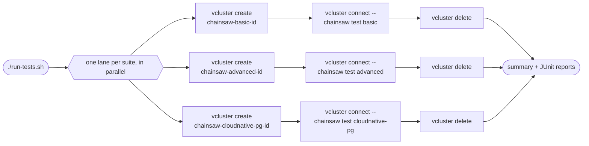
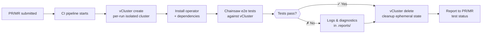

# 03 · Chainsaw + vCluster: the dream team for testing operators

[← 02 vCluster](../02_vcluster/README.md) · [Overview](../README.md)

## Why combine them?

| Problem when testing operators with Chainsaw on a shared cluster | How vCluster solves it |
|---|---|
| Namespaces don't isolate CRDs, ClusterRoles, webhooks or operator namespaces | Each suite gets its own control plane, so cluster-scoped objects can't clash |
| Two branches or PRs install different CRD versions of the same operator | Each pipeline gets its own vCluster with its own CRDs |
| Leftovers from failed runs pollute the next run | The vCluster is deleted after the run, so everything is gone |
| One kind or CI cluster per suite is slow and expensive | A vCluster starts in seconds on the existing nodes |
| Tests of *nested operators* need the dependency operator installed cluster-wide | Install it inside the vCluster as part of the test |

**Chainsaw** describes *what* to test, declaratively. **vCluster** provides a disposable, fully isolated *where*.

## How it works: [`run-tests.sh`](./run-tests.sh)

Every folder containing a `chainsaw-test.yaml` is a suite. The script runs one lane per suite, all in parallel:



The core of each lane is three commands:

```bash
vcluster create "$name" --namespace "$name" --connect=false
vcluster connect "$name" --namespace "$name" --silent -- \
  chainsaw test --test-dir "$suite" --config .chainsaw.yaml \
    --report-format JUNIT-TEST --report-path "$REPORT_DIR" --report-name "$suite"
vcluster delete "$name" --namespace "$name"
```

`vcluster connect -- <cmd>` hands the command a temporary `KUBECONFIG` that points at the virtual cluster. Chainsaw doesn't know or care that it's talking to a vCluster.

Because the whole vCluster is thrown away, [`.chainsaw.yaml`](./.chainsaw.yaml) sets `cleanup.skipDelete: true`, so Chainsaw doesn't spend time deleting resources one by one.

## The tests

| Suite | What it proves |
|---|---|
| [basic](./basic/chainsaw-test.yaml) | Same as [01 basic](../01_chainsaw/README.md#basic-apply-a-deployment-and-assert-readiness): apply a Deployment and assert it's ready |
| [advanced](./advanced/chainsaw-test.yaml) | Same as [01 advanced](../01_chainsaw/README.md#advanced-create-assert-ready-delete-pods-assert-ready-again): assert ready, delete pods, assert ready again |
| [cloudnative-pg](./cloudnative-pg/chainsaw-test.yaml) | **Multi-controller test:** install an operator, let it create a PostgreSQL cluster, and verify the database works end to end |

The basic and advanced tests are unchanged from [01](../01_chainsaw/README.md). Moving to vCluster needs **zero changes to the tests**.

### Multi-controller test: CloudNativePG

[CloudNativePG](https://github.com/cloudnative-pg/cloudnative-pg) is a good stand-in for "an operator your operator depends on". It installs CRDs, ClusterRoles and webhooks, all cluster-scoped. Its own controller then creates Pods, PVCs, Services and Secrets for each `Cluster` CR.

## Demo

Run the commands from this folder (`03_chainsaw-with-vcluster/`), against the kind cluster from the [setup](../README.md#setup).

```bash
watch kubectl get po -A
```

```bash
cd 03_chainsaw-with-vcluster
kubectl config use-context kind-chainsaw-vcluster-demo
./run-tests.sh
```

### 2. Optional: While it runs: watch the vClusters come and go

Run these in a second terminal:

```bash
kubectl get pods -A -l app=vcluster -w                   # vCluster control planes on the host
```

```bash
kubectl get pods -A -l vcluster.loft.sh/managed-by -w   # synced pods of all vClusters on the host
```

Cluster-scoped resources never reach the host. This finds no CNPG CRDs, even while CNPG is installed in its vCluster:

```bash
kubectl get crd | grep cnpg
```

### 3. Optional: Look at the results

```bash
ls .reports/*/                                      # one log and one JUnit XML per suite
tail -n 20 "$(ls -td .reports/*/ | head -1)/cloudnative-pg.log"
```

### 4. Optional: Run selected suites only

```bash
./run-tests.sh basic advanced
```

### 5. Debug: keep the vCluster and look around

```bash
KEEP_VCLUSTERS=true ./run-tests.sh cloudnative-pg
vcluster list
```

Use the name printed by the script:

```bash
vcluster connect chainsaw-cloudnative-pg-<id> --namespace chainsaw-cloudnative-pg-<id> --silent -- kubectl get clusters.postgresql.cnpg.io -A
vcluster delete  chainsaw-cloudnative-pg-<id> --namespace chainsaw-cloudnative-pg-<id>
```

### 6. Optional: The same in CI

The script only needs a reachable host cluster, so a CI job is just a few lines. Here's a GitHub Actions example:

```yaml
jobs:
  e2e:
    runs-on: ubuntu-latest
    steps:
      - uses: actions/checkout@v4
      - uses: helm/kind-action@v1
      - uses: kyverno/action-install-chainsaw@main
      - uses: loft-sh/setup-vcluster@main
      - run: ./prototypes/k8s-operator-testing-with-chainsaw-and-vcluster/03_chainsaw-with-vcluster/run-tests.sh
      - uses: actions/upload-artifact@v4
        if: always()
        with:
          name: chainsaw-reports
          path: prototypes/k8s-operator-testing-with-chainsaw-and-vcluster/03_chainsaw-with-vcluster/.reports
```

In a real setup, the host doesn't have to be kind. A long-lived shared CI cluster works, because every pipeline brings its own vCluster.

## Use Case one vCluster per CI run

Let's assume you're in a dev team and you'd like to run CI runs on your PRs/MRs in separated isolated environments. You could use vCluster to create per CI-run environment and run Chainsaw e2e tests of your dev project (e.g. a Kubernetes Operator) against this environment.



## Takeaways

- **Chainsaw** gives operators declarative, KRM-native e2e tests that are retried until consistent and collect diagnostics on failure.
- **vCluster** turns cluster-scoped state into per-test state: CRDs, RBAC and webhooks are isolated, and environments are ephemeral and cheap.
- **Together:** every suite runs in parallel in a fresh cluster of its own, including multi-operator scenarios, with zero changes to the tests.

## Follow-up

- [netbox-community/netbox-operator](https://github.com/netbox-community/netbox-operator/): a real-world operator with Chainsaw e2e tests ([`tests/e2e`](https://github.com/netbox-community/netbox-operator/tree/main/tests/e2e)) and a vCluster-based test environment ([`kind/deploy-netbox.sh`](https://github.com/netbox-community/netbox-operator/blob/main/kind/deploy-netbox.sh))
- [Kyverno Chainsaw](https://github.com/kyverno/chainsaw) · [docs](https://kyverno.github.io/chainsaw/latest/)
- [vCluster](https://github.com/loft-sh/vcluster) · [architecture](https://www.vcluster.com/docs/vcluster/introduction/architecture)
- [CloudNativePG](https://github.com/cloudnative-pg/cloudnative-pg)
- Approach us for further examples using vCluster and Chainsaw
