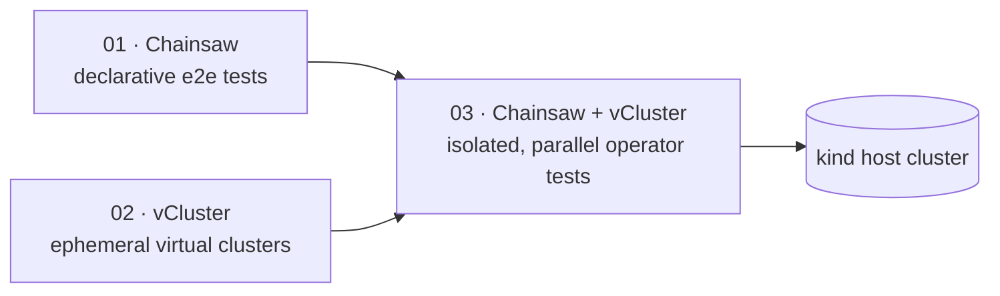

# Testing Kubernetes Operators with Chainsaw and vCluster

> Declarative end-to-end tests for Kubernetes operators, each one running in its own disposable virtual cluster.



## Agenda

| # | Topic | Contents |
|---|-------|----------|
| 1 | [Kyverno Chainsaw](./01_chainsaw/README.md) | What it is, what it's for, and a demo with a basic and an advanced test |
| 2 | [vCluster](./02_vcluster/README.md) | What it is, what it's for, and a demo of two isolated virtual clusters on one host |
| 3 | [Chainsaw + vCluster](./03_chainsaw-with-vcluster/README.md) | Each test suite gets its own ephemeral vCluster, all suites run in parallel, plus a multi-controller test with CloudNativePG |
| ➜ | [Follow-up links](#follow-up) | Real-world usage and further reading |

## Folder structure

```text
.
├── README.md                     # this file
├── 01_chainsaw/
│   ├── README.md                 # Chainsaw explained + copy-paste demo
│   ├── .chainsaw.yaml            # chainsaw configuration (timeouts, parallelism)
│   ├── basic/                    # apply a Deployment -> assert ready
│   └── advanced/                 # ... -> delete pods -> assert ready again
├── 02_vcluster/
│   └── README.md                 # vCluster explained + copy-paste demo
└── 03_chainsaw-with-vcluster/
    ├── README.md                 # the combination + copy-paste demo
    ├── .chainsaw.yaml
    ├── run-tests.sh              # one ephemeral vcluster per suite, in parallel
    ├── basic/
    ├── advanced/
    └── cloudnative-pg/           # multi-controller: install operator -> create Postgres -> smoke test
```

## Prerequisites

You need a working container runtime where `kind create cluster` works, for example Docker, Podman or Colima. On top of that you need these CLIs on your `PATH`:

| Tool | Purpose | Install |
|------|---------|---------|
| [kind](https://kind.sigs.k8s.io/) | local host cluster | `brew install kind` |
| [kubectl](https://kubernetes.io/docs/tasks/tools/) | talk to clusters | `brew install kubectl` |
| [chainsaw](https://kyverno.github.io/chainsaw/latest/quick-start/install/) | run the tests | `brew tap kyverno/chainsaw https://github.com/kyverno/chainsaw && brew install kyverno/chainsaw/chainsaw` |
| [vcluster](https://www.vcluster.com/docs/vcluster/#deploy-vcluster) | virtual clusters | `brew install loft-sh/tap/vcluster` |
| [helm](https://helm.sh/docs/intro/install/) | install CloudNativePG in the multi-controller test | `brew install helm` |

> [!TIP]
> With Podman, export `KIND_EXPERIMENTAL_PROVIDER=podman` before running `kind`. Nothing else in this demo depends on the container runtime.

## Setup

Run this from this folder:

```bash
mkdir "$PWD/.kube"
export KUBECONFIG="$PWD/.kube/chainsaw-vcluster-demo-kubeconfig"
tmux
```

```bash
kind create cluster --name chainsaw-vcluster-demo
kubectl config use-context kind-chainsaw-vcluster-demo

# Pre-pull and load images
docker pull docker.io/coredns/coredns:1.14.2 && kind load docker-image --name chainsaw-vcluster-demo docker.io/coredns/coredns:1.14.2
docker pull ghcr.io/cloudnative-pg/cloudnative-pg:1.30.2 && kind load --name chainsaw-vcluster-demo docker-image ghcr.io/cloudnative-pg/cloudnative-pg:1.30.2
docker pull ghcr.io/cloudnative-pg/postgresql:18.7-system-trixie && kind load docker-image --name chainsaw-vcluster-demo ghcr.io/cloudnative-pg/postgresql:18.7-system-trixie
docker pull ghcr.io/loft-sh/vcluster-pro:0.38.0 && kind load docker-image --name chainsaw-vcluster-demo ghcr.io/loft-sh/vcluster-pro:0.38.0
docker pull nginx:alpine && kind load docker-image --name chainsaw-vcluster-demo nginx:alpine
```

Then follow the demo sections in [01](./01_chainsaw/README.md), [02](./02_vcluster/README.md) and [03](./03_chainsaw-with-vcluster/README.md).

## Teardown

```bash
kind delete cluster --name chainsaw-vcluster-demo
```

## Follow-up

- [netbox-community/netbox-operator](https://github.com/netbox-community/netbox-operator/): an open source operator with dozens of Chainsaw e2e tests in [`tests/e2e`](https://github.com/netbox-community/netbox-operator/tree/main/tests/e2e). Its CI deploys the test environment into a vCluster ([`kind/deploy-netbox.sh`](https://github.com/netbox-community/netbox-operator/blob/main/kind/deploy-netbox.sh)).
- [Kyverno Chainsaw](https://github.com/kyverno/chainsaw), with [docs](https://kyverno.github.io/chainsaw/latest/) and [examples](https://kyverno.github.io/chainsaw/latest/examples/)
- [vCluster](https://github.com/loft-sh/vcluster), with [docs](https://www.vcluster.com/docs/vcluster/) and [architecture](https://www.vcluster.com/docs/vcluster/introduction/architecture)
- [CloudNativePG](https://github.com/cloudnative-pg/cloudnative-pg), the operator used in the multi-controller test
- [kyverno-json assertion trees](https://kyverno.github.io/kyverno-json/latest/intro/), the assertion engine behind Chainsaw
